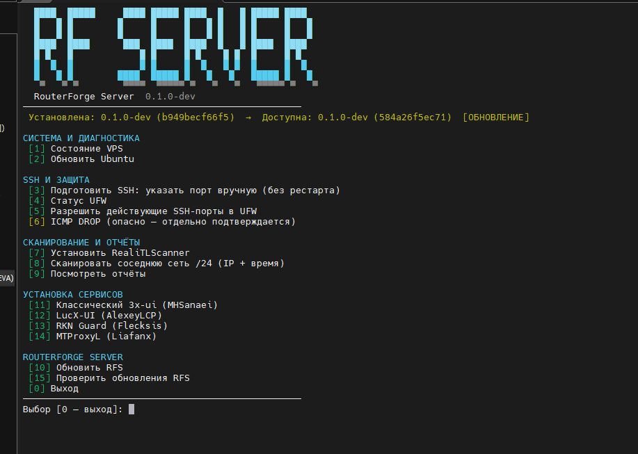

<div align="center">

<a href="https://github.com/Fifth-Ace/routerforge"></a>

# RF Server / RouterForge Server

**Ubuntu VPS management CLI · TLS diagnostics · service installers**

[🇷🇺 Русский](README.md) · [🇬🇧 English](README.en.md)

[](https://github.com/Fifth-Ace/routerforge-server/tree/dev)
[](https://github.com/Fifth-Ace/routerforge-server/actions/workflows/verify.yml)

</div>

> **Project status:** development and the installer live on the [`dev` branch](https://github.com/Fifth-Ace/routerforge-server/tree/dev). The `main` branch does not yet contain a stable installer.

## Terminal interface



**English documentation.** [Основная документация на русском](README.md)

RouterForge Server is a standalone Ubuntu VPS management CLI. The `dev` branch contains work in progress; `main` is reserved for a separately promoted stable release.

## Features

- Read-only VPS status and opt-in Ubuntu package updates.
- Custom SSH port preparation **without restarting SSH or ssh.socket**; UFW is never automatically enabled.
- RealiTLScanner: select a directly assigned public IPv4, choose scan time (120 seconds by default), see a countdown and a compact TLS log with up to 30 recent successful connections (limited by terminal height).
- Scanner output includes IP, TLS certificate domain and issuer, and optional GeoIP country from `Country.mmdb`. New reports have `GEO_CODE`; old reports are not modified.
- View previous reports through the menu (scope, filtered output, completion messages).
- Optional third-party installers: classic 3x-ui, LucX-UI, RKN Guard, and MTProxyL. Existing x-ui installations are protected against automatic replacement.
- Update checks and user-confirmed self-updates. No unattended update installation.

## Installation (dev)

Download and inspect the bootstrap before running it as root:

```bash
curl -fsSLo /tmp/rfs-bootstrap.sh https://raw.githubusercontent.com/Fifth-Ace/routerforge-server/dev/bootstrap.sh
sudo bash /tmp/rfs-bootstrap.sh --channel=dev --install
rfs
```

On first interactive installation choose `1 — Russian (default)` or `2 — English`. For non-interactive installs, use `--lang=ru` or `--lang=en`.

## Language

Menu option **17 — Language**, or `sudo rfs lang ru` / `sudo rfs lang en`. The setting is stored in `/opt/routerforge-server/language` and survives self-updates. RU is the default; EN is secondary. Scanner raw logs and CSV column identifiers stay in their original machine-readable format.

## Commands

```bash
rfs                 # Menu
rfs status          # VPS status
rfs scan            # TLS scan
rfs reports         # Scan reports
rfs check-update    # Check RFS updates
rfs self-update     # Update with confirmation
rfs language        # Language selector
```

## Data and security

Reports are under `/var/lib/routerforge-server/reports/`; program files are under `/opt/routerforge-server/`.

Network scanning requires explicit authorization from the network owner/provider. Choosing an IPv4 determines the neighboring `/24` scope but does **not** bind the outgoing TCP source IP. `Country.mmdb` is optional and country attribution is approximate. The scanner works without it.

SSH and UFW are never changed automatically by an RFS update. ICMP DROP rules can harm path MTU discovery. Upstream external installers can modify services and firewall rules and require explicit confirmation.

GitHub HTTPS and the selected branch are currently the update trust root; a commit SHA is not an independent digital signature.
