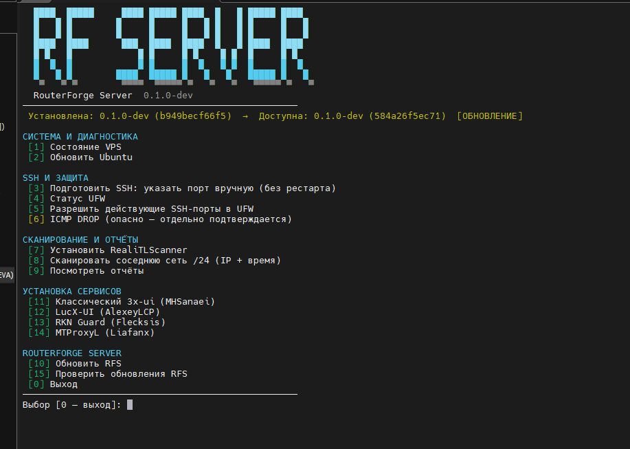

<div align="center">

<a href="https://github.com/Fifth-Ace/routerforge"></a>

# RF Server / RouterForge Server

**Консольное управление VPS · TLS-диагностика · установщики сервисов**

[🇷🇺 Русский](README.md) · [🇬🇧 English](README.en.md)

[](https://github.com/Fifth-Ace/routerforge-server/tree/dev)
[](https://github.com/Fifth-Ace/routerforge-server/actions/workflows/verify.yml)

</div>

> **Статус проекта:** текущая разработка и установщик находятся в ветке [`dev`](https://github.com/Fifth-Ace/routerforge-server/tree/dev). В `main` пока нет стабильного установщика.

## Интерфейс



**Русский — основной язык проекта.** [English documentation](README.en.md)

RouterForge Server — самостоятельный консольный менеджер VPS с цветным терминальным меню. Ведётся разработка в ветке `dev`; ветка `main` предназначена для стабильной версии после отдельной публикации.

## Возможности

- Статус Ubuntu/VPS без изменений системы.
- Обновление Ubuntu по подтверждению.
- Подготовка собственного SSH-порта **без рестарта SSH** и без автоматического включения UFW.
- Статус UFW, разрешение SSH-портов, отдельное опасное действие ICMP DROP.
- RealiTLScanner: выбор IP из назначенных публичных IPv4, выбор длительности (по умолчанию 120 секунд), живой TLS-журнал и таймер.
- Компактный вывод до **30 последних TLS-подключений** (в узком терминале количество видимых строк ограничено высотой окна).
- GeoIP `Country.mmdb`: необязательная установка/обновление, при отсутствии показывается `N/A`. В новых CSV добавлен `GEO_CODE`. Исторические отчёты остаются нетронутыми.
- Отчёты: выбор по номеру, просмотр параметров и результатов.
- Меню установщиков: классический 3x-ui, LucX-UI, RKN Guard, MTProxyL. Внешние установщики запускаются только после подтверждения; перезапись существующего x-ui заблокирована.
- Самообновление и автоматическая проверка новых коммитов. **Автоматического обновления без разрешения нет.**

## Установка из dev

Проверьте исходник перед запуском с привилегиями root. Пример команды для ознакомления и установки:

```bash
curl -fsSLo /tmp/rfs-bootstrap.sh https://raw.githubusercontent.com/Fifth-Ace/routerforge-server/dev/bootstrap.sh
sudo bash /tmp/rfs-bootstrap.sh --channel=dev --install
rfs
```

На **первой интерактивной установке** предлагается язык `1 — Русский` (по умолчанию) / `2 — English`.

Принудительный выбор без запроса:

```bash
sudo bash /tmp/rfs-bootstrap.sh --channel=dev --lang=en --install
```

## Выбор языка

`rfs` → пункт **17 «Язык / Language»**, либо команды `sudo rfs lang ru` и `sudo rfs lang en`.

Настройка сохраняется между обновлениями в `/opt/routerforge-server/language`. Формат CSV остаётся машиночитаемым с латинскими названиями колонок; итоговая таблица и пользовательские подписи локализуются. Технические сообщения внешних приложений не изменяются.

## Команды

```bash
rfs                    # Главное меню
rfs status             # Статус сервера
rfs scan               # TLS-сканирование
rfs reports            # Просмотр отчётов
rfs check-update       # Проверка обновлений
rfs self-update        # Обновление по подтверждению
rfs language           # Переключение языка
```

## Где лежат данные

- Программа: `/opt/routerforge-server/`.
- Логи и отчёты: `/var/lib/routerforge-server/reports/`.
- Каждый новый отчёт: `scope.txt`, `raw.csv`, `filtered.csv`, `summary.txt`, `scanner.log`.

## Безопасность

- SSH/ssh.socket не перезапускаются автоматически; подготовка порта не означает его активацию.
- UFW не включается автоматически. ICMP DROP может нарушить Path MTU Discovery.
- Сканирование адресов соседней `/24` допускается **только с разрешения владельца сети/провайдера**. Выбор VPS-IP задаёт целевую `/24`, не исходящий адрес TCP-соединений.
- GeoIP определяет предполагаемую страну адреса по локальной базе, но не гарантирует географическое положение сервера или принадлежность домена.
- GitHub HTTPS + выбранная ветка являются текущим источником доверия; SHA коммита не заменяет криптографическую подпись релиза.

## Версии и каналы

`dev` — разработка, `main` — стабильная линия. Отдельных feature-веток нет. Версию программы показывает `VERSION` в `manager.sh`, версию Ubuntu — только диагностика ОС.

[English README](README.en.md)
